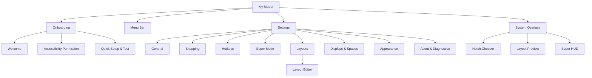
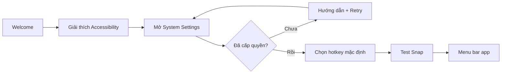
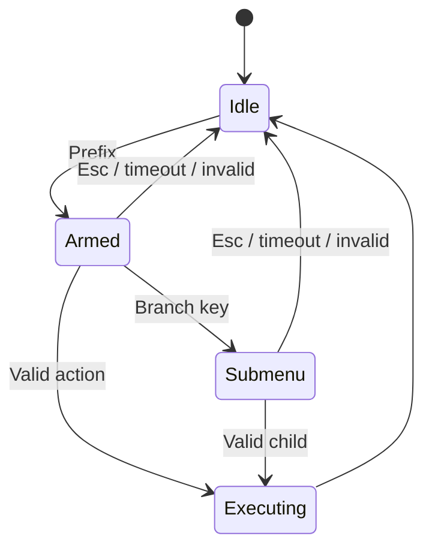
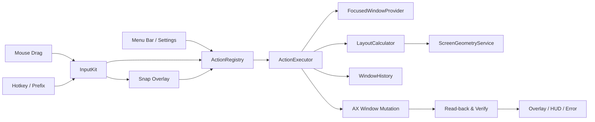
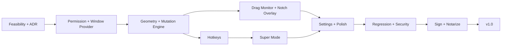

# My Mac X — Product, Design & Engineering Project Plan

> Phiên bản kế hoạch: 1.0  
> Ngày lập: 23/08/2026  
> Nền tảng: macOS native — Swift 6, AppKit + SwiftUI  
> Trạng thái: Blueprint để bắt đầu discovery và implementation  
> Phạm vi phát hành chính: Developer ID + Hardened Runtime + notarization

---

## 1. Tóm tắt quyết định

My Mac X là menu bar utility giúp việc sắp xếp và điều khiển cửa sổ trên macOS nhanh, trực quan và có thể thực hiện hoàn toàn bằng bàn phím.

Ba trải nghiệm cốt lõi:

1. **Notch Snap:** kéo cửa sổ vào vùng Notch hoặc giữa cạnh trên để mở bộ chọn layout như Windows 11.
2. **Custom Hotkeys:** gán hotkey cho mọi window action, có phát hiện xung đột và cycle kích thước.
3. **Super Mode:** nhấn prefix rồi nhập chuỗi lệnh như tmux để thực hiện các action sâu.

Các quyết định nền tảng:

- `Maximize` là phóng cửa sổ vào toàn bộ `visibleFrame`, không tạo Space mới.
- `Native Full Screen` là action riêng và được xem là bất đồng bộ vì macOS có thể tạo/chuyển Space.
- v1 cam kết di chuyển cửa sổ giữa **màn hình vật lý**, không cam kết chuyển tùy ý cửa sổ của ứng dụng khác sang Desktop/Space N.
- Không dùng private SkyLight APIs trong production.
- v1 là local-first, không cần tài khoản, cloud hay Screen Recording.
- Chỉ yêu cầu Accessibility; Input Monitoring chỉ được yêu cầu nếu runtime preflight chứng minh cấu hình event tap cần quyền này.
- Minimum deployment target đề xuất: **macOS 14 Sonoma** để giảm ma trận QA. Spike kỹ thuật có thể đánh giá hạ xuống macOS 13 nếu cần mở rộng người dùng.
- Tổng UI cần thiết kế: **16 surface chính + 4 dialog/toast hỗ trợ = 20 product surfaces**, tối thiểu **38 trạng thái** cần kiểm thử.
- Tổng effort v1 dự kiến: **125–145 person-days**; khoảng **14–16 tuần** với hai luồng kỹ sư chính và sub-agents. Một technical MVP có thể đạt trong 10–12 tuần nếu scope được giữ chặt và có ba luồng agent song song.

### 1.1 Mốc phát hành

| Mốc | Nội dung | Dự kiến |
|---|---|---:|
| Technical prototype | Resize app thật, hotkey PoC, overlay top-center | Cuối tuần 2 |
| Internal alpha | Core layout, hotkey, menu bar, permission flow | Tuần 5–6 |
| Feature-complete MVP | Notch Snap, Super Mode, Settings | Tuần 8–10 |
| Signed beta | Hardened Runtime, notarized build, closed beta | Tuần 11–12 |
| v1.0 | Hardening, release package, privacy docs | Tuần 14–16 |
| Post-v1 R&D | Spaces/Desktop, tiling nhiều cửa sổ | Sau v1.0 |

---

## 2. Product vision

### 2.1 Vấn đề cần giải quyết

macOS có sẵn một số khả năng quản lý cửa sổ nhưng:

- Số lượng layout và tùy biến còn hạn chế.
- Flow chọn layout không được tối ưu cho máy có Notch.
- Hotkey mặc định không tạo được một hệ thống thao tác sâu, nhất quán.
- Power user khó điều khiển cửa sổ, màn hình và profile hoàn toàn bằng bàn phím.
- Các app hiện có thường chỉ mạnh ở một phía: mouse snapping hoặc keyboard automation.

### 2.2 Value proposition

> “Một lớp window management native còn thiếu của macOS: trực quan như Windows 11, nhanh như Raycast và có command mode như tmux.”

### 2.3 Persona

| Persona | Nhu cầu | Trải nghiệm ưu tiên |
|---|---|---|
| Người dùng phổ thông | Chia đôi/chia tư cửa sổ dễ hiểu | Notch Snap, menu bar quick actions |
| Knowledge worker | Nhiều app, nhiều màn hình, họp và tài liệu | Layout presets, move display, Undo |
| Developer/power user | Mọi thao tác bằng bàn phím | Custom hotkeys, Super Mode, cycle |
| Designer/video editor | Màn hình lớn và layout riêng | Custom layout, gap, display profiles |

### 2.4 Nguyên tắc sản phẩm

- Cảm giác như một phần native của macOS.
- Có phản hồi ngay nhưng không thay đổi cửa sổ trước khi người dùng xác nhận/thả chuột.
- Mọi action đều dùng chung một engine dù được gọi từ chuột, hotkey, menu bar hay Super Mode.
- Luôn có Undo/Restore.
- Không làm mất cửa sổ khỏi vùng nhìn thấy.
- Không ghi nội dung phím, title tài liệu, clipboard hoặc ảnh màn hình.
- Experimental phải được gắn nhãn và có failure-safe rõ ràng.

### 2.5 Success metrics

| Nhóm | Chỉ số mục tiêu |
|---|---|
| Onboarding | Người dùng biết lý do cần quyền trước khi macOS hiển thị prompt; hoàn tất trong ≤ 90 giây nếu chủ động cấp quyền |
| Chính xác | Preview và frame cuối sai lệch ≤ 1 logical point, trừ giới hạn minimum size của app đích |
| Hotkey | p95 từ key event đến lúc bắt đầu AX action < 100 ms trên máy support thấp nhất |
| Overlay | Xuất hiện ổn định sau dwell, không flicker và không lấy focus |
| Hiệu năng | Idle CPU gần 0%; không polling liên tục; không tăng observer/memory sau 500 action |
| Độ tin cậy | Không crash khi app đích đóng/treo, display bị rút hoặc quyền bị thu hồi |
| Input safety | Không mất phím/modifier khi Super Mode timeout hoặc cancel |
| Release | Không có P0/P1 mở; signed/notarized build chạy trên máy sạch |

### 2.6 Không thuộc MVP/v1

- Tạo, xóa hoặc đổi tên macOS Spaces.
- Chuyển tùy ý cửa sổ của ứng dụng khác sang Space N bằng private API.
- Quản lý đầy đủ Stage Manager sets.
- Layout editor canvas tự do có overlap.
- Restore workspace gồm nhiều app cùng lúc.
- iCloud sync, account, team sync.
- Rule theo window title/document content.
- Plugin/scripting API.
- Phát hành đồng thời Mac App Store trước khi permission feasibility được xác nhận.

---

## 3. Hệ thống tính năng

### 3.1 Feature matrix

| ID | Hệ thống | Tính năng | Ưu tiên | Release | Tiêu chí nghiệm thu chính |
|---|---|---|---|---|---|
| SYS-01 | Permission | Accessibility onboarding và health check | P0 | MVP | Granted/denied/revoked đều phản ánh đúng, không cần restart |
| SYS-02 | Window Core | Lấy focused window và capabilities | P0 | MVP | Hoạt động với app native, Chromium và Electron đại diện |
| SYS-03 | Layout | Maximize, halves, quarters, top/bottom | P0 | MVP | Không vượt `visibleFrame`; gap/padding đúng |
| SYS-04 | Layout | Thirds, two-thirds, center, increments | P1 | v1 | Có cycle group và clamp theo minimum size |
| SYS-05 | History | Undo/Restore theo từng cửa sổ | P0 | MVP | Không nhầm hai cửa sổ cùng process |
| SYS-06 | Display | Move next/previous physical display | P0 | MVP | Giữ tỷ lệ hoặc dùng profile màn hình đích |
| SYS-07 | Notch Snap | Trigger, chooser, preview, drop/cancel | P0 | MVP | Không lấy focus, Esc/kéo ra hủy được |
| SYS-08 | Non-Notch | Fallback giữa cạnh trên | P0 | MVP | Hành vi tương đương Notch trigger |
| SYS-09 | Hotkey | Custom global hotkeys | P0 | MVP | Đổi runtime, lưu qua restart |
| SYS-10 | Hotkey | Recorder và conflict detection | P0 | MVP | Không cho lưu binding trùng/không hợp lệ |
| SYS-11 | Super Mode | Prefix, sequence 1–2 cấp, timeout | P0 | v1 | Không capture ngoài trạng thái armed |
| SYS-12 | Super Mode | HUD và command tree | P0 | v1 | HUD không focus; Esc/timeout luôn thoát |
| SYS-13 | Layout Editor | Split/merge grid layout | P1 | v1 | Không overlap, không ra ngoài canvas |
| SYS-14 | App Rules | Include/exclude ứng dụng | P1 | v1 | Rule có hiệu lực runtime và có fallback |
| SYS-15 | Profiles | Gap/layout theo display | P1 | v1 | Profile ổn định khi display reconnect |
| SYS-16 | Settings | General, Snapping, Hotkeys, Super, Layouts | P0 | MVP | Mọi setting quan trọng có hiệu lực runtime |
| SYS-17 | Config | Import/export + schema migration | P1 | v1 | Validate input; config cũ không làm crash |
| SYS-18 | Diagnostics | Permission/event tap/system status | P1 | v1 | Copy report đã redaction |
| SYS-19 | Lifecycle | Launch at Login, sleep/wake recovery | P1 | v1 | Không tạo duplicate tap/observer |
| SYS-20 | Native Full Screen | Action riêng có timeout | P2 | v1 | Không khóa action pipeline |
| SYS-21 | Accessibility UX | VoiceOver, contrast, Reduce Motion | P0 | v1 | Toàn bộ Settings/overlay có keyboard path |
| SYS-22 | Release | Signing, notarization, update/rollback | P0 | v1 | Gatekeeper pass trên máy sạch |
| SYS-X1 | Spaces | Move external window to Space N | Experimental | Post-v1 | Chỉ ship nếu có giải pháp public, ổn định |
| SYS-X2 | Tiling | Nhiều cửa sổ, adjacency/resize propagation | Experimental | Post-v1 | Prototype riêng, không ảnh hưởng Window Core |

### 3.2 Layout mặc định

| Nhóm | Layout |
|---|---|
| Full | Maximize, Native Full Screen riêng |
| Halves | Left, Right, Top, Bottom |
| Quarters | Top Left, Top Right, Bottom Left, Bottom Right |
| Thirds | Left Third, Center Third, Right Third |
| Two-thirds | Left Two-thirds, Right Two-thirds |
| Utility | Center, Restore, Undo, Move Next/Previous Display |

### 3.3 Action registry đề xuất

```text
window.maximize
window.native-full-screen
window.left-half
window.right-half
window.top-half
window.bottom-half
window.top-left-quarter
window.top-right-quarter
window.bottom-left-quarter
window.bottom-right-quarter
window.left-third
window.center-third
window.right-third
window.left-two-thirds
window.right-two-thirds
window.center
window.undo
window.restore
window.move-display-next
window.move-display-previous
app.open-settings
app.pause-resume
profile.toggle-gaps
profile.select.<id>
experimental.space.<n>
```

---

## 4. UX architecture và số lượng màn hình

### 4.1 Information architecture



### 4.2 Inventory: 20 product surfaces

| # | ID | Surface | Loại | Trạng thái bắt buộc |
|---:|---|---|---|---|
| 1 | UI-01 | Welcome | Onboarding | First launch |
| 2 | UI-02 | Accessibility Permission | Onboarding | Not requested, denied, granted, revoked |
| 3 | UI-03 | Quick Setup & Test | Onboarding | Recording, conflict, test success |
| 4 | UI-04 | Menu Bar Popover | Popover | Active window, no window, unsupported window |
| 5 | UI-05 | General | Settings | Active, paused, permission missing |
| 6 | UI-06 | Snapping | Settings | Notch, non-Notch, disabled |
| 7 | UI-07 | Hotkeys | Settings | Normal, recording, conflict |
| 8 | UI-08 | Super Mode | Settings | Disabled, enabled, invalid prefix |
| 9 | UI-09 | Layout Library | Settings | Defaults, custom, empty custom set |
| 10 | UI-10 | Displays & Spaces | Settings | Single, multiple, disconnected display |
| 11 | UI-11 | Appearance | Settings | System, light, dark, reduced effects |
| 12 | UI-12 | About & Diagnostics | Settings | Healthy, missing permission, event tap disabled |
| 13 | UI-13 | Layout Editor | Editor | Create, edit, invalid, unsaved |
| 14 | UI-14 | Notch Layout Chooser | Overlay | Trigger, hover, keyboard focus, cancel |
| 15 | UI-15 | Layout Preview | Overlay | Mouse preview, hotkey preview, constrained target |
| 16 | UI-16 | Super Mode HUD | Overlay | Waiting, submenu, success, invalid, timeout |
| 17 | UI-17 | Hotkey Conflict | Dialog | Replace, choose another, cancel |
| 18 | UI-18 | Experimental Spaces Warning | Dialog | Acknowledge, enabled, failed test |
| 19 | UI-19 | Undo/Failure Feedback | Toast/HUD | Undo available, unsupported window, action failed |
| 20 | UI-20 | Permission Lost Banner | Banner | Revoked, open settings, recovered |

Tối thiểu 38 state cần visual QA:

- Onboarding: 7.
- Menu bar: 3.
- Settings và editor: 20.
- Overlays/dialog/toast: 8+.

### 4.3 User flows

#### Flow A — Lần đầu mở



#### Flow B — Snap bằng Notch

```text
Kéo cửa sổ
→ con trỏ vào trigger zone
→ dwell 120–180 ms
→ chooser mở dưới Notch/cạnh trên
→ hover/focus layout
→ preview target frame
→ mouse-up để áp dụng
→ lưu history
→ hiển thị Undo ngắn gọn
```

#### Flow C — Hotkey

```text
Nhấn hotkey
→ resolve action
→ lấy focused window/display
→ preview ngắn 80–120 ms
→ apply + verify frame
→ lưu frame cũ
→ nhấn lại để cycle nếu action có cycle group
```

#### Flow D — Super Mode



#### Flow E — Custom layout

```text
Layouts → New Layout
→ chọn grid/split vùng
→ đặt name/gap/padding
→ validate overlap/minimum size
→ Preview on Display
→ Save
→ layout xuất hiện trong chooser và Action Registry
```

---

## 5. Project design mockup

### 5.1 Visual direction

- Native macOS, tối giản, ưu tiên system controls và SF Symbols.
- Settings dùng sidebar giống System Settings.
- Overlay dùng material/blur phù hợp nhưng phải có fallback khi Reduce Transparency bật.
- Không dùng dashboard card thừa, gradient trang trí hoặc icon quá lớn.
- Notch chooser là “signature interaction” của sản phẩm.

### 5.2 Design tokens

| Token | Giá trị đề xuất |
|---|---|
| Typeface | SF Pro / system font; SF Mono cho keycap khi cần |
| Window title | 20 pt Semibold |
| Section title | 13 pt Semibold |
| Body/control | 13 pt Regular |
| Supporting text | 11–12 pt Regular |
| Base spacing | 4 pt; control gap 8 pt; group gap 16–20 pt |
| Settings size | 880 × 620 pt; minimum 760 × 520 pt |
| Menu popover | 320 × 430 pt |
| Notch chooser | 420–560 × 110–150 pt |
| Super HUD | Compact 320 × 64 pt; expanded tối đa 460 × 240 pt |
| Panel radius | 10–12 pt |
| Overlay motion | 120–160 ms ease-out; fade-only với Reduce Motion |
| Preview | System Blue 18–25% fill + high-contrast border |

Luôn dùng semantic colors (`labelColor`, `secondaryLabelColor`, system blue/green/orange/red) thay vì khóa cứng màu trong production.

### 5.3 Mockup — Onboarding

```text
┌────────────────────────────────────────────────────────────┐
│                         My Mac X                            │
│                                                            │
│               Quản lý cửa sổ theo cách của bạn             │
│                                                            │
│       [ cửa sổ  →  Notch chooser  →  snapped window ]      │
│                                                            │
│  • Kéo cửa sổ vào Notch để chọn layout                     │
│  • Điều khiển toàn bộ bằng hotkey                          │
│  • Tạo layout riêng cho từng màn hình                      │
│                                                            │
│              [Bắt đầu thiết lập]                            │
│                    Thiết lập sau                            │
└────────────────────────────────────────────────────────────┘

┌────────────────────────────────────────────────────────────┐
│  Cho phép điều khiển cửa sổ                                │
│                                                            │
│  My Mac X cần Accessibility để thay đổi vị trí và kích     │
│  thước cửa sổ. Ứng dụng không đọc nội dung bạn nhập.       │
│                                                            │
│  Accessibility Permission                                 │
│  [ ! ] Chưa được cấp                                      │
│                                                            │
│  1. Mở Privacy & Security                                  │
│  2. Chọn Accessibility                                     │
│  3. Bật My Mac X                                           │
│                                                            │
│  [Mở System Settings]                     [Kiểm tra lại]    │
│  ← Quay lại                                      Tiếp →    │
└────────────────────────────────────────────────────────────┘
```

### 5.4 Mockup — Notch Snap và preview

```text
┌──────────────────────────── MacBook display ────────────────────────────┐
│                         ┌──── NOTCH ────┐                               │
│                         └───────────────┘                               │
│                  ╭────────────────────────────╮                         │
│                  │ Maximize  Halves  Quarters │                         │
│                  │                            │                         │
│                  │ ┌───┐  ┌───┬───┐  ┌─┬─┐  │                         │
│                  │ │███│  │███│   │  │█│ │  │                         │
│                  │ │███│  │███│   │  ├─┼─┤  │                         │
│                  │ └───┘  └───┴───┘  └─┴─┘  │                         │
│                  │ Full    Left 1/2   Top-left│                         │
│                  ╰────────────────────────────╯                         │
│                                                                         │
│  ╔══════════════════════════╗  ┌────────────────────────────────────┐   │
│  ║                          ║  │ dragged application window         │   │
│  ║     Left Half Preview    ║  │                                    │   │
│  ║                          ║  └────────────────────────────────────┘   │
│  ╚══════════════════════════╝                                           │
│      Left Half · 50%                           Esc để hủy                │
└─────────────────────────────────────────────────────────────────────────┘
```

Interaction notes:

- Chỉ label item đang hover/focus để chooser không rối.
- Arrow keys có thể thay đổi selection trong lúc giữ chuột.
- Preview chỉ là vùng màu bán trong suốt, không giả lập nội dung app.
- Nếu target nhỏ hơn minimum size của app, preview chuyển warning và hiển thị frame thực tế có thể áp dụng.

### 5.5 Mockup — Menu bar

```text
┌────────────────────────────────────┐
│ My Mac X                       [⚙] │
├────────────────────────────────────┤
│ Current Window                     │
│ Safari — Project research          │
│                                    │
│ [ Left ] [ Right ] [ Maximize ]    │
│ [ TL   ] [ TR    ] [ Center   ]    │
│                                    │
├────────────────────────────────────┤
│ Undo Last Move               ⌥⌘Z   │
│ Move to Next Display         ⌥⌘N   │
│                                    │
│ Super Mode                  On  ●   │
│ Snapping                    On  ●   │
├────────────────────────────────────┤
│ Pause My Mac X                     │
│ Settings…                    ⌘,    │
│ Quit My Mac X                     │
└────────────────────────────────────┘
```

### 5.6 Mockup — Settings shell

```text
┌────────────────────────────────────────────────────────────────────────┐
│ ● ● ●                         My Mac X                                 │
├──────────────────┬─────────────────────────────────────────────────────┤
│ General          │ General                                             │
│ Snapping         │                                                     │
│ Hotkeys          │ Launch at Login                         [ On ]       │
│ Super Mode       │ Show in Dock                            [ Off ]      │
│ Layouts          │ Show menu bar icon                      [ On ]       │
│ Displays & Spaces│                                                     │
│ Appearance       │ Window behavior                                     │
│ About            │ Default gap                             [  8 pt ]   │
│                  │ Preserve size when moving display        [ On ]      │
│                  │                                                     │
│                  │ Status                                              │
│                  │ Accessibility                         [✓ Granted]    │
│                  │                                         [Review…]   │
├──────────────────┴─────────────────────────────────────────────────────┤
│ Version 1.0                                                 [Help]     │
└────────────────────────────────────────────────────────────────────────┘
```

### 5.7 Mockup — Hotkeys

```text
┌──────────────────────────────────────────────────────────────────────┐
│ Hotkeys                                          [Search actions…]   │
│                                                                      │
│ Window Position                                                      │
│ ┌──────────────────────────────────────────────────────────────────┐ │
│ │ Left Half                 [ ⌥ ][ ⌘ ][ ← ]       [Record] [×]    │ │
│ │ Right Half                [ ⌥ ][ ⌘ ][ → ]       [Record] [×]    │ │
│ │ Maximize                  [ ⌥ ][ ⌘ ][ ↩ ]       [Record] [×]    │ │
│ │ Center                    [ Not assigned ]       [Record]        │ │
│ └──────────────────────────────────────────────────────────────────┘ │
│                                                                      │
│ Displays                                                             │
│ │ Move to Next Display      [ ⌥ ][ ⌘ ][ N ]       [Record] [×]    │
│                                                                      │
│ [Restore Defaults]                      [Import…] [Export…]           │
└──────────────────────────────────────────────────────────────────────┘

Conflict:
┌──────────────────────────────────────────────────────────────────────┐
│ [!] ⌥⌘← đang được dùng bởi “Previous Display”.                       │
│     [Replace Existing] [Choose Another]                              │
└──────────────────────────────────────────────────────────────────────┘
```

### 5.8 Mockup — Super Mode settings và HUD

```text
┌──────────────────────────────────────────────────────────────────────┐
│ Super Mode                                             [ Enabled ● ] │
│ Prefix key             [ ⌃ ][ Space ]                  [Record]      │
│ Sequence timeout       [──────●────────] 1.5 seconds                 │
│ Show command HUD                                      [ On ]         │
│ Consume invalid key                                   [ Off ]        │
│                                                                      │
│ Command Map                                                          │
│ H  Left Half      L  Right Half      J  Bottom      K  Top          │
│ M… Move Display   S… Move Space      C  Settings    R  Restore      │
│                                            [Edit Command Map…]        │
└──────────────────────────────────────────────────────────────────────┘

                    ╭────────────────────────────────╮
                    │  SUPER › MOVE DISPLAY          │
                    │  H Previous       L Next       │
                    │  1…4 Select display  Esc Cancel│
                    ╰────────────────────────────────╯
```

### 5.9 Mockup — Layout library/editor

```text
┌──────────────────────────────────────────────────────────────────────┐
│ Layouts                                             [+ New Layout]   │
│ Built-in:  [ Full ] [ Halves ] [ Quarters ] [ Thirds ]              │
│                                                                      │
│ Custom                                                               │
│ ┌──────────────┐  ┌──────────────┐  ┌──────────────┐                 │
│ │ ┌───┬────┐   │  │ ┌─┬─┬─┐      │  │ ┌─────┬──┐   │                 │
│ │ └───┴────┘   │  │ └─┴─┴─┘      │  │ └─────┴──┘   │                 │
│ │ Coding [Edit]│  │ 3 Cols [Edit]│  │ Focus [Edit] │                 │
│ └──────────────┘  └──────────────┘  └──────────────┘                 │
└──────────────────────────────────────────────────────────────────────┘

┌────────────────────────────────────────────────────────────────────────┐
│ ← Layouts      Edit Layout: Coding                  [Cancel] [Save]    │
├──────────────────────────────────────────────┬─────────────────────────┤
│  Display Preview                             │ Layout                  │
│  ┌────────────────────────────────────────┐  │ Name [Coding          ] │
│  │ Region 1             │ Region 2        │  │ Grid: 3 cols × 2 rows  │
│  │                      ├─────────────────┤  │ Outer gap [8 pt]        │
│  │                      │ Region 3        │  │ Inner gap [8 pt]        │
│  └────────────────────────────────────────┘  │ Selected: Region 2      │
│  [+ Split Vertical] [+ Split Horizontal]     │ X 50% Y 0% W 50% H 50%│
│  [Merge] [Delete Region]                     │ [Preview on Display ▾]  │
└──────────────────────────────────────────────┴─────────────────────────┘
```

### 5.10 Mockup — Displays & Experimental Spaces

```text
┌──────────────────────────────────────────────────────────────────────┐
│ Displays & Spaces                                                    │
│                                                                      │
│      ┌───────────────────┐   ┌───────────────────────────┐            │
│      │ 1 · MacBook       │   │ 2 · Studio Display       │            │
│      │ 1512 × 982        │   │ 2560 × 1440              │            │
│      │ [Primary]         │   │                           │            │
│      └───────────────────┘   └───────────────────────────┘            │
│                                                                      │
│ Keep proportional size                                  [ On ]       │
│ Use destination display layout                          [ On ]       │
│ Edge cycle order                                        [1 → 2 ▾]    │
│ ──────────────────────────────────────────────────────────────────── │
│ Spaces                                             Experimental       │
│ Enable Space actions                                    [ Off ]       │
│ Tính năng có thể thay đổi theo phiên bản macOS.                       │
│ Status: Disabled                              [Learn More]             │
└──────────────────────────────────────────────────────────────────────┘
```

### 5.11 UX acceptance criteria

- Chọn được mọi layout mặc định bằng chuột và bàn phím.
- Chooser luôn xuất hiện đúng display và không nhảy vị trí.
- `Esc` hủy chooser, recorder, dialog và Super Mode.
- Không dùng màu làm tín hiệu duy nhất.
- Target tương tác tối thiểu khoảng 44 × 44 pt.
- VoiceOver đọc tên, vị trí và tỷ lệ layout.
- Hỗ trợ Light/Dark, Increase Contrast, Reduce Motion và Reduce Transparency.
- Layout Editor không cho save vùng overlap/out-of-bounds.
- Display bị ngắt không để overlay/window restore nằm ngoài vùng nhìn thấy.

---

## 6. Kiến trúc kỹ thuật

### 6.1 Tech stack

| Thành phần | Công nghệ |
|---|---|
| App lifecycle/menu bar | AppKit, `NSApplicationDelegate`, `NSStatusItem` |
| Settings/onboarding | SwiftUI host trong AppKit window |
| Overlay/HUD | Non-activating `NSPanel`, AppKit/SwiftUI content |
| Window control | ApplicationServices Accessibility (`AXUIElement`) |
| Input | CoreGraphics event tap/global mouse events |
| Geometry | `NSScreen`, CoreGraphics display identifiers |
| Launch at Login | `SMAppService` |
| Persistence | Versioned Codable schema + UserDefaults/file trong Application Support |
| Logging | OSLog với privacy/redaction |
| Tests | XCTest, pure geometry/property tests, UI/snapshot tests |
| Release | Developer ID, Hardened Runtime, notarization, DMG/ZIP |

### 6.2 Module map

```text
MyMacXApp
├── AppShell
│   ├── AppDelegate / MenuBarController
│   ├── DependencyContainer
│   └── AppLifecycleCoordinator
├── PermissionKit
│   ├── AccessibilityPermissionService
│   └── PermissionOnboardingCoordinator
├── AXWindowKit
│   ├── FocusedWindowProvider
│   ├── WindowCapabilitiesReader
│   ├── WindowFrameReaderWriter
│   ├── AXObserverCoordinator
│   └── AXErrorMapper
├── ScreenKit
│   ├── ScreenRepository
│   ├── CoordinateConverter
│   ├── NotchGeometryResolver
│   └── ScreenChangeObserver
├── LayoutKit
│   ├── LayoutDefinition / LayoutCalculator
│   ├── LayoutCatalog
│   ├── GapAndPaddingPolicy
│   └── WindowConstraintResolver
├── CommandKit
│   ├── WindowAction / ActionRegistry
│   ├── ActionExecutor
│   ├── WindowHistoryStore
│   └── ApplicationRulesEngine
├── InputKit
│   ├── GlobalHotkeyService / EventTapService
│   ├── HotkeyConflictDetector
│   ├── LeaderKeyStateMachine
│   └── PointerDragTracker
├── OverlayKit
│   ├── SnapOverlayPanel / SnapPreviewPanel
│   ├── LeaderHUDPanel
│   └── OverlayCoordinator
├── SettingsFeature
├── PersistenceKit
└── DiagnosticsKit
```

### 6.3 Runtime architecture



### 6.4 Boundary rules

- `LayoutKit` là pure Swift, không phụ thuộc AppKit/AX.
- `AXWindowKit` không chứa logic layout.
- Mọi entry point đi qua `ActionRegistry` và `ActionExecutor`.
- Event tap callback không gọi AX, không làm I/O và không logging nặng; chỉ chuyển event sang queue/actor.
- `AXUIElement` bị giới hạn trong actor/serial executor do Swift 6 strict concurrency.
- UI và `NSPanel` ở `MainActor`; AX calls chạy ngoài main thread với messaging timeout.
- Không cache `visibleFrame` lâu dài; cập nhật khi screen parameters/Dock/menu bar thay đổi.
- Không hard-code Notch; suy ra từ safe area/auxiliary areas và có top-center fallback.

### 6.5 Domain model

```swift
struct ScreenDescriptor {
    let displayID: CGDirectDisplayID
    let frame: CGRect
    let visibleFrame: CGRect
    let safeAreaInsets: NSEdgeInsets
    let notchRegion: CGRect?
    let backingScaleFactor: CGFloat
}

struct LayoutDefinition: Codable, Identifiable {
    let id: String
    let normalizedRegions: [CGRect]
    let padding: CGFloat
    let gap: CGFloat
    let cycleGroup: String?
}

struct WindowAction: Codable, Identifiable {
    let id: String
    let operation: Operation
    let displayPolicy: DisplayPolicy
    let restorePolicy: RestorePolicy
}

struct HotkeyBinding: Codable {
    let hardwareKeyCode: UInt16
    let modifiers: ModifierMask
    let actionID: String
}

struct LeaderSequence: Codable {
    let prefix: HotkeyBinding
    let steps: [UInt16]
    let timeout: Duration
    let actionID: String
}
```

### 6.6 Window action pipeline

```text
Input event
→ resolve Action ID
→ focused AX window
→ capability/settable checks
→ select target display
→ calculate target frame
→ save WindowSnapshot
→ set size/position
→ read back actual frame
→ accept, clamp feedback or rollback on failure
```

### 6.7 Notch trigger pipeline

```text
leftMouseDragged
+ focused window moved notification
→ determine current display
→ calculate notch/top-center trigger
→ dwell + hysteresis
→ show non-activating chooser
→ hover/focus target
→ preview frame
→ mouseUp: execute or cancel
```

### 6.8 Spaces strategy

- AppKit public collection behavior chủ yếu áp dụng cho cửa sổ thuộc chính ứng dụng.
- v1 chỉ hỗ trợ physical displays.
- `experimental.space.*` action bị feature-flag off trong production.
- Post-v1 spike phải loại bỏ phương án private API trước khi đề xuất ship.
- Failure không được thay đổi frame hiện tại hoặc làm mất focus/window.

---

## 7. Chiến lược dùng GPT models và sub-agents

### 7.1 Model selection

Theo [OpenAI Models](https://developers.openai.com/api/docs/models), GPT-5.6 Sol phù hợp cho complex reasoning/coding, Terra cân bằng năng lực và chi phí, Luna dành cho workload lặp lại, số lượng lớn và nhạy chi phí. [Model guidance](https://developers.openai.com/api/docs/guides/latest-model) khuyến nghị bắt đầu ở `medium`, dùng `low` cho latency, nâng lên `high/xhigh` khi có chất lượng đo được và dành `max` cho workload khó nhất.

| Mã dùng trong backlog | Model đầy đủ | Dùng cho |
|---|---|---|
| **SOL-XH** | `gpt-5.6-sol`, reasoning `xhigh` | Kiến trúc lõi, coordinate/event state, security/release blocker |
| **SOL-H** | `gpt-5.6-sol`, reasoning `high` | AX, Event Tap, concurrency, complex debugging/review |
| **SOL-M** | `gpt-5.6-sol`, reasoning `medium` | Product/design synthesis có judgment cao |
| **TERRA-H** | `gpt-5.6-terra`, reasoning `high` | SwiftUI/AppKit interaction, stateful feature implementation |
| **TERRA-M** | `gpt-5.6-terra`, reasoning `medium` | Implementation mặc định, persistence, CI, refactor rõ scope |
| **LUNA-M** | `gpt-5.6-luna`, reasoning `medium` | Fixtures/test matrix/schema checks có dependency |
| **LUNA-L** | `gpt-5.6-luna`, reasoning `low` | Scaffold, microcopy, docs, release notes, mechanical checks |
| **SOL-MAX** | `gpt-5.6-sol`, reasoning `max` | Ngoại lệ: lỗi nghiêm trọng khó tái hiện hoặc Spaces feasibility |

Sau Sprint 1, đo task success, số vòng review, latency và chi phí; hạ một mức reasoning nếu chất lượng không đổi.

### 7.2 Agent topology — tối đa 4 agent đồng thời

| Agent | Model mặc định | Ownership |
|---|---|---|
| A0 — Orchestrator/Integrator | SOL-H | Task breakdown, interface, dependency, merge, quality gate |
| A1 — Core Window System | SOL-H | PermissionKit, AXWindowKit, Window mutation, history |
| A2 — Interaction/UI | TERRA-H | InputKit integration, OverlayKit, Settings, HUD |
| A3 — Geometry/QA/Release | TERRA-M | ScreenKit, LayoutKit, tests, CI/signing; SOL review khi release |

Luna chạy theo batch thay cho một agent implementation khi cần sinh fixtures, test cases, microcopy hoặc docs. Không để Luna tự quyết định entitlement, architecture hoặc Accessibility behavior.

### 7.3 Quy tắc cộng tác

- Protocol-first: chốt `FocusedWindowProviding`, `WindowControlling`, `LayoutCalculating`, `ActionExecuting` trước khi chia implementation.
- Một module có đúng một owner trong mỗi sprint.
- Không để hai agent cùng sửa AppDelegate, DependencyContainer, ActionRegistry hoặc schema persistence.
- Mỗi sub-agent trả: changed files, test results, assumptions, known gaps.
- Core/security code bắt buộc SOL-H/XH review.
- Các thao tác người thật không giao hoàn toàn cho agent: cấp quyền hệ thống, test kéo chuột, multi-display, signing credential và Go/No-Go.

---

## 8. Product backlog chi tiết — task, dependency, model

Estimate dùng **person-day (PD)**. Model code tham chiếu mục 7.1.

### Phase 0 / Sprint 0 — Discovery, feasibility và UX

| ID | Task | Output / Acceptance | Est. | Dependency | Model |
|---|---|---|---:|---|---|
| P0-01 | Chốt persona, thuật ngữ maximize/full screen/Space và MVP | Product brief được duyệt | 2 PD | — | TERRA-M |
| P0-02 | Feature matrix và acceptance criteria | Mọi P0 feature có AC đo được | 2 PD | P0-01 | TERRA-M |
| P0-03 | Spike focused window + AX resize trên 6 app | Move/resize Safari, Finder, Terminal, Xcode, Chrome, Electron | 3 PD | P0-01 | SOL-H |
| P0-04 | Spike global hotkey/Event Tap | Prefix + suppression PoC; ghi permission behavior | 3 PD | P0-01 | SOL-H |
| P0-05 | Spike Notch/safe-area/multi-screen coordinates | PoC đúng Notch/non-Notch và origin âm | 3 PD | P0-03 | SOL-XH |
| P0-06 | Thiết kế module/protocol/ADR | Dependency graph và boundary được duyệt | 3 PD | P0-03…05 | SOL-XH |
| P0-07 | Threat model, data inventory, distribution | Chốt local-first, Developer ID, entitlement policy | 2 PD | P0-03…04 | SOL-H |
| P0-08 | UX flow, tokens và clickable/ASCII mockup review | Sign-off 20 surfaces và primary flows | 2 PD | P0-01…02 | SOL-M |

**Gate G0:** resize được cửa sổ app khác trên máy thật; overlay PoC không lấy focus; xác nhận Spaces ngoài v1.

### Phase 1 / Sprint 1 — Foundation và quyền hệ thống

| ID | Task | Output / Acceptance | Est. | Dependency | Model |
|---|---|---|---:|---|---|
| F1-01 | Tạo Xcode project, configs, folder/modules, test targets | Clean build Debug/Release | 2 PD | P0-06 | TERRA-M |
| F1-02 | Menu bar lifecycle, accessory policy, single instance | Không hiện Dock/không lấy focus ngoài ý muốn | 3 PD | F1-01 | TERRA-M |
| F1-03 | AccessibilityPermissionManager | Granted/denied/revoked/deep-link hoạt động runtime | 4 PD | P0-03, F1-01 | SOL-H |
| F1-04 | FocusedWindowProvider + WindowCapabilities | Phân biệt movable/resizable/minimized/full-screen | 4 PD | P0-03 | SOL-H |
| F1-05 | ScreenGeometryService | Visible frame, scale, origin, safe area đúng | 4 PD | P0-05 | SOL-H |
| F1-06 | Privacy-safe logging và error taxonomy | Không log key/title; có AX/Input error domain | 2 PD | F1-01 | TERRA-M |
| F1-07 | AX/screen fakes và geometry fixtures | Tests không phụ thuộc app thật | 2 PD | F1-04…05 | LUNA-M |
| F1-08 | CI skeleton: build, unit, lint/static checks | PR pipeline xanh trên clean runner | 2 PD | F1-01 | TERRA-M |

**Gate G1:** app chạy ở menu bar, onboarding permission đúng và core adapters có unit test doubles.

### Phase 2 / Sprint 2 — Window Layout Engine

| ID | Task | Output / Acceptance | Est. | Dependency | Model |
|---|---|---|---:|---|---|
| W2-01 | Layout model + normalized geometry | Maximize/halves/quarters/top-bottom chính xác | 4 PD | F1-05 | TERRA-H |
| W2-02 | WindowMutationService | Set size/position, bounded retry, read-back verify | 4 PD | F1-04, W2-01 | SOL-H |
| W2-03 | CoordinateConverter AX/AppKit/CoreGraphics | Property tests origin âm/scaling pass | 3 PD | F1-05 | SOL-XH |
| W2-04 | Gap, padding, rounding, minimum-size clamp | Không vượt visible frame > 1 pt | 3 PD | W2-01…03 | TERRA-H |
| W2-05 | WindowHistory/Undo/Restore | Phân biệt cửa sổ cùng app; stale refs được dọn | 3 PD | W2-02 | TERRA-H |
| W2-06 | Cycle 1/2 → 2/3 → 1/3 | Repeat action cycle ổn định theo window | 3 PD | W2-01, W2-05 | TERRA-M |
| W2-07 | Move physical display | Giữ tỷ lệ/clamp theo display đích | 4 PD | W2-02…04 | SOL-H |
| W2-08 | Screen attach/detach/reorder observer | Không để target/restore ngoài màn hình | 3 PD | F1-05, W2-07 | SOL-H |
| W2-09 | Special windows handling | Sheet/dialog/non-resizable có safe fallback | 3 PD | W2-02 | SOL-H |
| W2-10 | Native full-screen asynchronous action | Observer/timeout; không block pipeline | 3 PD | W2-02 | SOL-H |
| W2-11 | Layout property-test generator | ≥ 200 boundary cases | 2 PD | W2-01…08 | LUNA-M |
| W2-12 | Real-app integration harness | 100 snap liên tiếp, không crash/leak rõ ràng | 3 PD | W2-02…10 | TERRA-H |

**Gate G2:** API thống nhất `perform(action:on:)`, 8+ layout, Undo và multi-display pass.

### Phase 3 / Sprint 3 — Global hotkeys

| ID | Task | Output / Acceptance | Est. | Dependency | Model |
|---|---|---|---:|---|---|
| H3-01 | Global hotkey lifecycle | Register/unregister, sleep/wake không duplicate | 4 PD | P0-04, F1-02 | SOL-H |
| H3-02 | Stable ActionRegistry | UI/Input không gọi trực tiếp AX | 3 PD | W2-02 | TERRA-M |
| H3-03 | Hotkey recorder | Hardware code/modifier hiển thị đúng | 3 PD | H3-01 | TERRA-H |
| H3-04 | Conflict detection | Nội bộ, invalid và reserved common shortcuts | 3 PD | H3-03 | SOL-H |
| H3-05 | Versioned SettingsStore + migrations | Config tồn tại qua restart, fallback khi corrupt | 3 PD | H3-02…04 | TERRA-M |
| H3-06 | Runtime binding updates | Thay binding có hiệu lực không restart | 2 PD | H3-01…05 | TERRA-M |
| H3-07 | Key mapping/input source tests | US/ABC/Vietnamese Telex pass | 2 PD | H3-01…06 | LUNA-M |

**Gate G3:** alpha dùng được hoàn toàn bằng custom hotkeys, conflict được báo trước Save.

### Phase 4 / Sprint 4 — Notch Snap Overlay

| ID | Task | Output / Acceptance | Est. | Dependency | Model |
|---|---|---|---:|---|---|
| N4-01 | PointerDragTracker + AX moved signal | Nhận diện kéo thật, không bật khi chỉ rê chuột | 4 PD | F1-04…05 | SOL-XH |
| N4-02 | Notch/top-center trigger engine | Notch, non-Notch, nhiều display đúng | 3 PD | N4-01, W2-03 | SOL-H |
| N4-03 | Dwell/hysteresis/debounce | Không flicker; dwell configurable 120–180 ms | 2 PD | N4-02 | SOL-H |
| N4-04 | Non-activating chooser panel | Không key/main, không vào app switcher | 4 PD | P0-08, N4-02 | TERRA-H |
| N4-05 | Layout picker + keyboard focus | Mouse/arrow keys chọn mọi default layout | 4 PD | N4-04, H3-02 | TERRA-H |
| N4-06 | Preview overlay | Khớp final frame ≤ 1 pt; warning minimum size | 3 PD | W2-04, N4-04 | SOL-H |
| N4-07 | Drop/cancel state machine | Mouse-up, Esc, drag-out đều deterministic | 4 PD | N4-01…06 | SOL-XH |
| N4-08 | Cross-display drag | Overlay chuyển display đúng, không để orphan panel | 3 PD | N4-02…07 | SOL-H |
| N4-09 | Motion/accessibility states | Reduce Motion/Transparency/Contrast pass | 2 PD | N4-04…06 | TERRA-H |
| N4-10 | Snapshot/visual regression | Light/dark/notch/non-notch snapshots | 2 PD | N4-04…09 | LUNA-M |

**Gate G4:** kéo lên Notch/cạnh trên, preview và thả để snap hoạt động ổn định trên máy thật.

### Phase 5 / Sprint 5 — Super Mode

| ID | Task | Output / Acceptance | Est. | Dependency | Model |
|---|---|---|---:|---|---|
| S5-01 | EventTap lifecycle/recovery | Callback nhẹ; tự enable khi timeout/user disabled | 3 PD | P0-04, H3-01 | SOL-H |
| S5-02 | Leader state machine | Idle/armed/submenu/execute/cancel deterministic | 4 PD | S5-01, H3-02 | SOL-XH |
| S5-03 | Prefix/sequence config | Prefix, timeout, 1–2 cấp và conflict validation | 3 PD | S5-02, H3-05 | TERRA-H |
| S5-04 | Super HUD | Waiting/submenu/success/error; không lấy focus | 3 PD | S5-02, N4-04 | TERRA-H |
| S5-05 | Advanced actions | Restore/cycle/move display/settings/gap/profile | 3 PD | W2-05…07, S5-02 | TERRA-M |
| S5-06 | Input safety policy | Chỉ swallow khi chắc chắn; không log text/key stream | 3 PD | S5-01…03 | SOL-H |
| S5-07 | Timeout/rapid-input tests | Không mất ký tự/modifier; Esc luôn cancel | 3 PD | S5-01…06 | LUNA-M + SOL review |

**Gate G5:** feature-complete beta có thể thao tác hoàn toàn bằng prefix sequence.

### Phase 6 / Sprint 6 — Settings, profiles và polish

| ID | Task | Output / Acceptance | Est. | Dependency | Model |
|---|---|---|---:|---|---|
| U6-01 | Menu bar quick actions | Active/no/unsupported window states đúng | 3 PD | H3-02, W2 | TERRA-H |
| U6-02 | Settings shell + General/Snapping | Runtime settings và permission status đúng | 4 PD | F1, N4 | TERRA-H |
| U6-03 | Hotkeys/Super settings | Recorder/conflict/tree editing accessible | 4 PD | H3, S5 | TERRA-H |
| U6-04 | Layout Library + split/merge editor | Không save overlap/out-of-bounds | 5 PD | W2-01…04 | SOL-H |
| U6-05 | Display profiles | Gap/layout set theo stable display ID | 4 PD | W2-07…08 | SOL-H |
| U6-06 | Per-app include/exclude rules | Rule runtime, default safe behavior | 3 PD | W2-09, H3-05 | TERRA-H |
| U6-07 | Import/export config | Schema validation, migration, no machine secrets | 3 PD | H3-05, U6-02…06 | TERRA-H |
| U6-08 | About/Diagnostics | Permission/tap/OS/app status; redacted report | 3 PD | F1-06, S5-01 | TERRA-M |
| U6-09 | Accessibility and appearance pass | VoiceOver/keyboard/contrast/reduced effects | 3 PD | U6-01…08 | TERRA-H |
| U6-10 | Microcopy/localizable strings | Empty/error states nhất quán | 2 PD | U6-01…09 | LUNA-L |
| U6-11 | Performance pass | Idle/event/overlay/memory budgets đạt | 4 PD | All features | SOL-H |

**Gate G6:** public beta: Settings đầy đủ, config backup được, UI có keyboard/VoiceOver path.

### Phase 7 / Sprint 7 — QA, security và release

| ID | Task | Output / Acceptance | Est. | Dependency | Model |
|---|---|---|---:|---|---|
| R7-01 | Regression suite + hardware matrix | Automated + manual report đầy đủ | 4 PD | G6 | TERRA-H |
| R7-02 | Permission/TCC lifecycle matrix | Fresh/deny/grant/revoke/update pass | 3 PD | F1-03, G6 | SOL-H |
| R7-03 | Event/AX privacy-security review | Call sites, logs, entitlements, data inventory pass | 3 PD | P0-07, G6 | SOL-XH |
| R7-04 | Soak/performance | 8h soak, 500 actions, attach/detach stable | 4 PD | G6 | SOL-H |
| R7-05 | Beta crash/hang/race triage buffer | Fix toàn bộ P0/P1 | 5–8 PD | R7-01…04 | SOL-H/XH |
| R7-06 | Hardened Runtime + minimal entitlements | Release archive pass security checks | 2 PD | R7-03 | SOL-H |
| R7-07 | Developer ID signing/notarization/staple | Gatekeeper pass trên máy sạch | 3 PD | R7-06 | TERRA-H + SOL review |
| R7-08 | DMG/ZIP + checksum | Immutable versioned artifact | 2 PD | R7-07 | TERRA-M |
| R7-09 | Updater/manual-update + rollback | Config preserved; signature/rollback verified | 3 PD | R7-07…08 | SOL-H |
| R7-10 | Privacy policy, FAQ, release notes | Giải thích permission/data rõ ràng | 2 PD | R7-03 | LUNA-L |
| R7-11 | Clean install/upgrade smoke test | Signed build chạy trên clean machine | 2 PD | R7-07…10 | TERRA-H |
| R7-12 | Go/No-Go review | Test report, known limits, rollback package | 1 PD | R7-01…11 | SOL-H |

**Gate G7:** v1.0 signed/notarized, không P0/P1, rollback sẵn sàng.

### Phase 8 — Post-v1 R&D

| ID | Task | Output / Acceptance | Est. | Dependency | Model |
|---|---|---|---:|---|---|
| X8-01 | Nghiên cứu public API cho Spaces/Desktop | Evidence matrix, không phỏng đoán API | 4 PD | v1.0 | SOL-MAX |
| X8-02 | Đánh giá system-shortcut simulation | Failure/focus/input/privacy analysis | 3 PD | X8-01 | SOL-XH |
| X8-03 | Tiling multi-window prototype | Adjacency graph + resize propagation PoC | 5 PD | v1.0 | SOL-XH |
| X8-04 | Ship/no-ship feasibility report | Loại private API; quyết định có tiêu chí rõ | 2 PD | X8-01…03 | SOL-H |

---

## 9. Timeline và parallel execution

### 9.1 Sprint roadmap

| Phase | Thời lượng | Exit gate |
|---|---:|---|
| Sprint 0 | 1 tuần | G0 — feasibility/ADR/mockup |
| Sprint 1 | 2 tuần | G1 — foundation/permissions |
| Sprint 2 | 2 tuần | G2 — layout/window engine |
| Sprint 3 | 2 tuần | G3 — hotkey alpha |
| Sprint 4 | 2 tuần | G4 — Notch Snap alpha |
| Sprint 5 | 2 tuần | G5 — Super Mode beta |
| Sprint 6 | 2 tuần | G6 — Settings/public beta |
| Sprint 7 | 2 tuần | G7 — release v1 |

### 9.2 Luồng agent theo tuần

| Tuần | A1 — Core Window | A2 — Interaction/UI | A3 — Geometry/QA/Release | A0 — Integrator |
|---:|---|---|---|---|
| 1 | AX/permission spike | Notch/hotkey/UX spike | Geometry spike + CI skeleton | Scope, ADR, protocols |
| 2 | Permission + AX provider | Menu bar + onboarding | Screen/LayoutKit foundations | G0/G1 integration |
| 3–4 | Window mutation/history | Hotkey recorder/settings | Geometry/property tests | ActionRegistry contract |
| 5–6 | Special windows/full-screen | Drag overlay/preview | Multi-display tests | End-to-end alpha gate |
| 7–8 | Event Tap/input safety review | Super Mode/HUD | Input/state tests | G5 integration |
| 9–10 | App rules/diagnostics | Settings/editor/polish | UI/accessibility QA | Schema freeze, beta |
| 11–12 | Performance/bug fixes | Bug fixes | Signing/notarization/soak | RC decision |
| 13–16 | Compatibility/beta fixes | UX polish | Regression/release | Go/No-Go + v1 |

### 9.3 Critical path



Critical path lớn nhất: `P0-03/P0-05 → F1-04/F1-05 → W2-02/W2-03 → N4-01/N4-07 → U6-11 → R7`.

---

## 10. Test strategy

### 10.1 Test pyramid

| Lớp | Nội dung | Khi chạy |
|---|---|---|
| Unit | Layout math, coordinate conversion, state machine, schema migration | Mọi PR |
| Adapter contract | AX wrappers với fake, capability/error mapping | Mọi PR |
| Integration | Focused window → action → read-back; hotkey → mutation | Nightly/core PR |
| UI/snapshot | Onboarding, Settings, chooser, HUD | UI PR |
| Manual system | Permission prompt, drag, display, sleep/wake, fullscreen | Beta/RC |
| Soak/performance | Event tap, rapid hotkeys, drag, screen attach/detach | Trước RC |

### 10.2 App compatibility matrix

- Finder.
- Safari.
- Terminal.
- Xcode.
- Google Chrome.
- Visual Studio Code hoặc Slack/Electron.
- System Settings.
- Một app có custom title bar.
- Cửa sổ không resizable.
- Sheet, dialog, popover và minimized window.
- Hai cửa sổ cùng process.
- App đóng hoặc treo giữa action.

### 10.3 Hardware/display matrix

- Apple Silicon MacBook có Notch.
- Mac không Notch hoặc desktop Mac.
- Hai màn hình có độ phân giải/scaling khác nhau.
- External display ở trái/phải/trên/dưới, có origin âm.
- Retina + non-Retina; landscape + portrait.
- Dock trái/phải/dưới, auto-hide.
- Menu bar auto-hide và separate Spaces on/off.
- Mirror mode.
- Cắm/rút display khi overlay đang mở.
- Stage Manager on/off.

### 10.4 Permission/lifecycle matrix

- Fresh install, chưa request.
- Deny, grant khi app đang mở, revoke trong runtime.
- Update app giữ nguyên bundle ID/signature.
- Sleep/wake, lock/unlock, fast user switching.
- Event tap bị `.tapDisabledByTimeout`/user input.
- App crash/relaunch khi observer/tap đang active.

### 10.5 Input matrix

- US, ABC, Vietnamese Telex và ít nhất một non-Latin layout.
- Keyboard tích hợp và external.
- Key repeat, rapid input, modifier held khi đổi app.
- Shortcut xung đột macOS/app khác.
- Prefix timeout đúng lúc focus/Space thay đổi.
- Secure text field/password manager: app không can thiệp ngoài sequence đăng ký.

### 10.6 Performance targets

- p95 hotkey dispatch đến AX action bắt đầu < 100 ms.
- Dwell timer sai số < 50 ms.
- Event tap callback không làm I/O, AX call hoặc logging nặng.
- Idle CPU gần 0%; không polling focused window liên tục.
- Preview/final frame sai số ≤ 1 point.
- 500 action và 100 display changes không tăng observer/memory bất thường.
- 8 giờ soak không duplicate tap/observer, hang hoặc crash.

---

## 11. Privacy, security và distribution

### 11.1 Data policy

- Local-first; không account/cloud trong v1.
- Telemetry mặc định tắt; nếu thêm sau phải opt-in.
- Chỉ quan sát event cần cho shortcut/drag state.
- Super Mode chỉ capture sau prefix và dừng ngay khi execute, timeout hoặc Escape.
- Không log typed text, raw key stream, window/document title, clipboard hay screenshot.
- Bundle ID trong diagnostics chỉ xuất khi cần và phải được redaction/consent.
- Window identity chỉ sống tạm trong memory và được dọn khi stale/app đóng.

### 11.2 Security checklist trước release

- Review mọi Accessibility/Event Tap call site.
- Validate config import: kích thước file, schema, giá trị frame và path.
- Redact diagnostics trước khi copy/export.
- Hardened Runtime và entitlement tối thiểu.
- Không link private frameworks/symbols; CI có static scan.
- Không network request ngoài updater/telemetry đã công bố.
- Update feed qua HTTPS và có signature/checksum.
- Signing/notarization keys chỉ ở secret store, không vào repo/log.
- SBOM/dependency/license inventory cho artifact release.
- Privacy policy giải thích lý do cần Accessibility và dữ liệu được/không được quan sát.

### 11.3 Release pipeline

```text
Release tag
→ clean build + full tests
→ archive
→ Developer ID codesign
→ notarize
→ staple
→ Gatekeeper verify trên máy sạch
→ DMG/ZIP + SHA-256
→ internal → beta → stable
→ monitor feedback
→ rollback nếu cần
```

Publish stable luôn có human Go/No-Go; không giao hoàn toàn cho automation/sub-agent.

---

## 12. Risk register

| Rủi ro | Mức | Giảm thiểu |
|---|---:|---|
| Không có public API ổn định cho external window → Space N | Critical | Loại khỏi v1; research riêng; không dùng private API |
| App đích hỗ trợ AX không đầy đủ | High | Capability check, read-back, timeout, per-app rules |
| `kAXErrorCannotComplete` khi app đích treo | High | AX executor ngoài main, messaging timeout, bounded retry |
| Sai hệ tọa độ nhiều display/origin âm | High | Một CoordinateConverter; ≥ 200 property tests |
| Event tap bị disable | High | Callback nhẹ, health check, bounded re-enable |
| Permission onboarding không đồng nhất | High | Runtime preflight, recheck, degraded UI rõ ràng |
| Overlay lấy focus hoặc làm rơi drag | High | Non-activating panel, không `makeKey`, own-process exclusion |
| CPU cao do polling | High | Event-driven, throttle/debounce, Instruments/soak gate |
| Swift 6 concurrency với AX CF objects | High | Thread-confined actor/serial executor, Sendable audit |
| Update làm TCC nhận app như binary mới | High | Bundle ID/signature ổn định, clean upgrade tests |
| Stage Manager tự sửa frame | Medium | Observe nhưng không “đấu” liên tục; known limitation |
| Shortcut xung đột | Medium | Recorder validation, warnings, easy pause/disable |
| Signing/notarization trễ | Medium | Chuẩn bị từ Sprint 1, thử notarize trước RC |
| Agent sửa chồng module/shared schema | Medium | File ownership, protocol-first, integrator-only merge |

---

## 13. Definition of Done

Mọi task chỉ được hoàn tất khi:

- Acceptance criteria đạt.
- Có test tự động hoặc lý do rõ ràng nếu bắt buộc manual.
- Error, permission-loss và fallback state được xử lý.
- Không thêm log dữ liệu nhạy cảm.
- ADR/config schema/help text được cập nhật nếu behavior thay đổi.
- Ít nhất một agent khác review; core/security cần Sol review.
- CI xanh và không tăng warning mới.
- Không dùng private API trong production target.

### v1.0 release gate

- Toàn bộ P0/P1 của v1 hoàn tất hoặc có quyết định scope rõ.
- Không còn P0/P1 bugs.
- Hardware/app/permission matrices đã chạy và lưu report.
- 8 giờ soak và performance budget pass.
- Signed/notarized artifact chạy trên máy sạch.
- Privacy policy, known limitations, release notes và rollback artifact sẵn sàng.

---

## 14. Tài liệu tham khảo chính thức

### Apple

- [AXUIElement](https://developer.apple.com/documentation/applicationservices/axuielement_h)
- [AXIsProcessTrustedWithOptions](https://developer.apple.com/documentation/applicationservices/1459186-axisprocesstrustedwithoptions)
- [AXUIElementSetAttributeValue](https://developer.apple.com/documentation/applicationservices/1460434-axuielementsetattributevalue)
- [CGEventTapCreate](https://developer.apple.com/documentation/coregraphics/cgevent/tapcreate%28tap%3Aplace%3Aoptions%3Aeventsofinterest%3Acallback%3Auserinfo%3A%29)
- [NSScreen.visibleFrame](https://developer.apple.com/documentation/appkit/nsscreen/visibleframe)
- [NSScreen.safeAreaInsets](https://developer.apple.com/documentation/appkit/nsscreen/safeareainsets)
- [NSScreen auxiliary top area](https://developer.apple.com/documentation/appkit/nsscreen/auxiliarytoprightarea-gr2n)
- [Screen parameters changed notification](https://developer.apple.com/documentation/appkit/nsapplication/didchangescreenparametersnotification)
- [SMAppService](https://developer.apple.com/documentation/servicemanagement/smappservice)
- [Notarizing macOS software](https://developer.apple.com/documentation/security/notarizing-macos-software-before-distribution)
- [App Sandbox restrictions](https://developer.apple.com/documentation/security/protecting-user-data-with-app-sandbox)

### OpenAI

- [OpenAI model catalog](https://developers.openai.com/api/docs/models)
- [GPT-5.6 model guidance](https://developers.openai.com/api/docs/guides/latest-model)

---

## 15. Các quyết định cần xác nhận ở Sprint 0

1. Minimum target macOS 14 hay mở rộng xuống macOS 13.
2. Import/export config thuộc MVP hay v1.
3. Updater tích hợp trong v1 hay manual download ở bản đầu.
4. Default prefix của Super Mode và policy cho invalid key.
5. Default dwell duration, gaps và layout set trong Notch chooser.
6. Có gửi diagnostics opt-in hay hoàn toàn offline.
7. Display profile nhận diện theo stable display ID hay thêm fallback theo model/resolution.
8. Native Full Screen thuộc default action set hay Advanced.
9. Closed beta size, supported app list và supported macOS versions.
10. Brand name cuối cùng, bundle identifier và Developer ID owner.

Khi chưa có quyết định khác, kế hoạch này dùng các default sau: macOS 14+, direct distribution, no telemetry, Import/Export trong v1, manual update có kiểm tra version cho beta và Super Mode prefix `⌃Space`.
